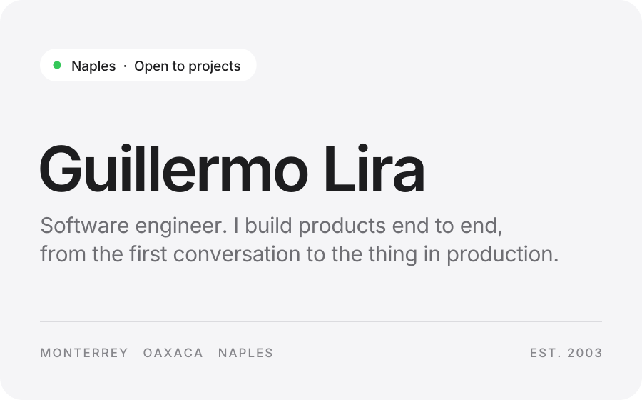
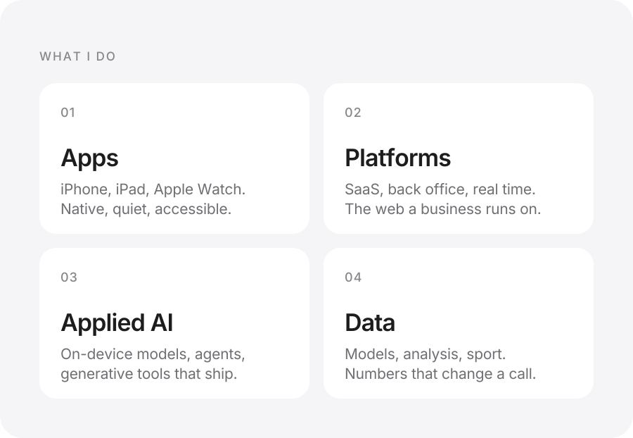
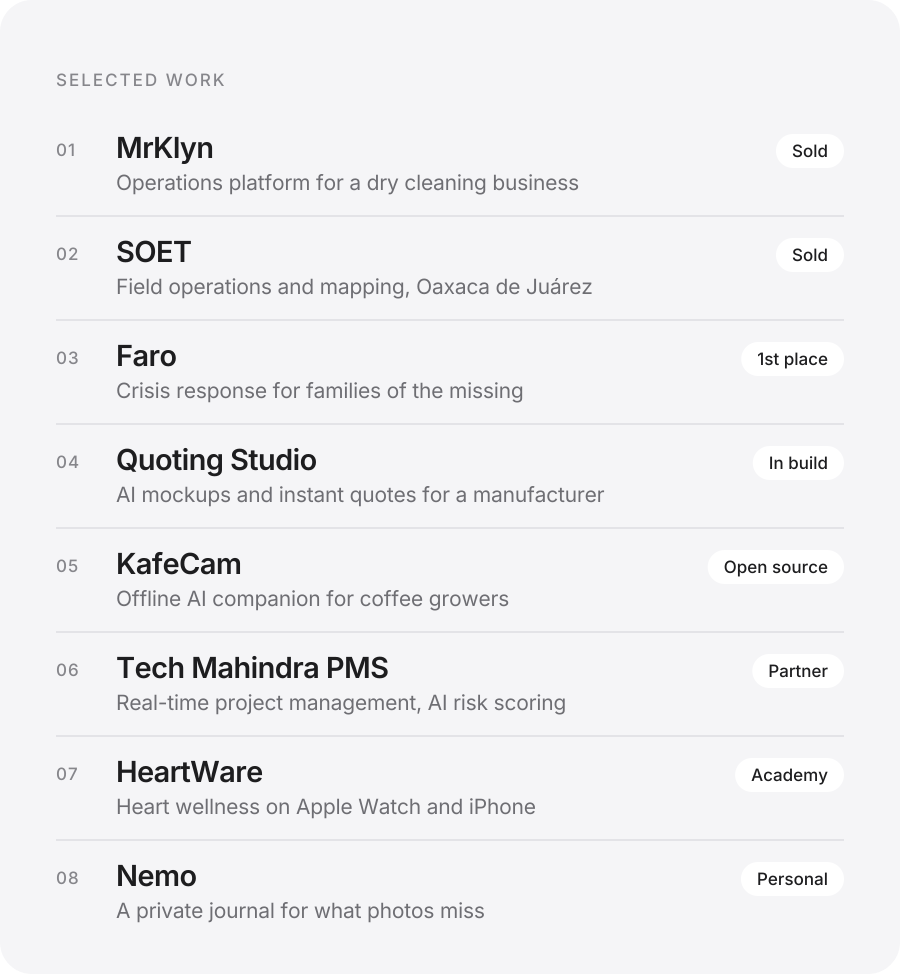
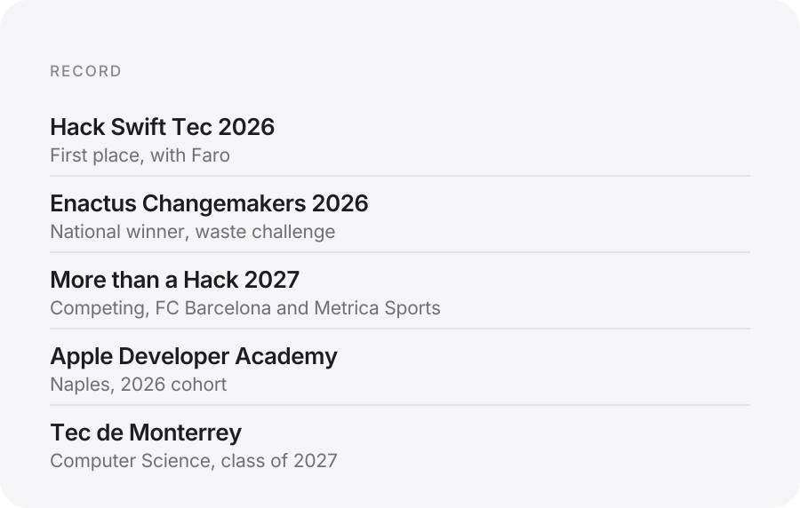

<picture>
  <source media="(prefers-color-scheme: dark)" srcset="assets/hero-dark.svg">
  
</picture>

 
 

I sit with the owner, watch how the work really happens, and then build whatever fixes it. Sometimes that's an iPhone app, sometimes a platform the whole staff logs into every morning, sometimes a model that runs on a phone in the middle of a coffee field with no signal.

Two of those platforms were bought by the businesses they were built for and run there every day. A few others won things. Most of my best work is private, so ask.

 

<picture>
  <source media="(prefers-color-scheme: dark)" srcset="assets/practice-dark.svg">
  
</picture>

 
 

<picture>
  <source media="(prefers-color-scheme: dark)" srcset="assets/work-dark.svg">
  
</picture>

Open to read: <a href="https://github.com/2kLira/KafeCam">KafeCam</a> &nbsp; <a href="https://github.com/2kLira/Project-Management-System-TechMahindra">Tech Mahindra PMS</a>

 
 

<picture>
  <source media="(prefers-color-scheme: dark)" srcset="assets/record-dark.svg">
  
</picture>

 
 

Swift, SwiftUI, SwiftData, Core ML, Foundation Models, MLX. 
Next.js, React, Node, Postgres, Supabase. Python for the data.

 

Monterrey, Oaxaca, Naples.

